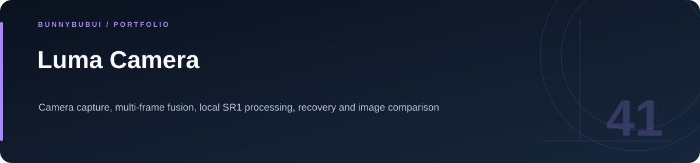
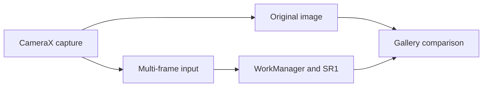

<p align="center">
  
</p>

<h1 align="center">Luma Camera</h1>

<p align="center">Camera capture, multi-frame fusion, local SR1 processing, recovery and image comparison</p>

<p align="center">
      
</p>

<p align="center"><a href="#overview">ภาพรวม</a> · <a href="#features">ความสามารถ</a> · <a href="#start">เริ่มใช้งาน</a> · <a href="#structure">โครงสร้าง</a> · <a href="#validation">ตรวจสอบงาน</a></p>

<a id="overview"></a>

## ภาพรวม

แอปกล้อง Android ที่เก็บต้นฉบับและสำเนาปรับภาพแยกกัน รองรับการถ่ายหลายเฟรม การประมวลผลบนเครื่อง และการเปรียบเทียบภาพด้วย CameraX และ WorkManager

<a id="features"></a>

## ความสามารถที่มีใน source

| ส่วนงาน | รายละเอียด | อ้างอิง |
|---|---|---|
| **Camera capture** | ถ่าย JPEG และ RAW ตามความสามารถกล้อง | [ดู source](app/src/main/java/th/ogay/luma/CameraActivity.kt) |
| **Multi-frame** | รับและจัดการภาพหลายเฟรม | [ดู source](app/src/main/java/th/ogay/luma/MultiFrameFusion.kt) |
| **Background work** | คิวประมวลผลภาพและการลองใหม่ | [ดู source](app/src/main/java/th/ogay/luma/EnhanceWorker.kt) |
| **Local model** | SR1 และขั้นตอนฝึกโมเดล | [ดู source](model/) |

### เส้นทางการทำงาน



<a id="start"></a>

## เริ่มต้นใช้งาน

**สิ่งที่ต้องมี:** JDK 17, Android SDK Platform 36 และ build tools ตามคู่มือกล้อง

```sh
./gradlew :app:testDebugUnitTest :app:lintDebug :app:assembleDebug
# Requires a compatible device or camera-enabled emulator
./gradlew :app:connectedDebugAndroidTest
```

ใช้ Android Studio ได้เช่นกัน ผล RAW/เลนส์และคุณภาพภาพขึ้นกับอุปกรณ์; ดูรายละเอียดการถ่ายและตรวจภาพในคู่มือกล้อง

<a id="structure"></a>

## โครงสร้างที่ควรเริ่มอ่าน

| ตำแหน่ง | หน้าที่ |
|---|---|
| [model/](model) | โมเดลและขั้นตอนฝึก |

<a id="validation"></a>

## คำสั่งและผลตรวจ

ใช้ Gradle ตามคำสั่งในหัวข้อเริ่มต้นและคู่มือ ดูผล workflow ปัจจุบันได้ในแท็บ [Actions](https://github.com/BunnyBubui/LumaCamera/actions)

<a id="scope"></a>

## ขอบเขตของงาน

จำนวนเฟรม คุณภาพภาพและเลนส์ที่ใช้ได้ขึ้นกับกล้องที่ Android เปิดให้แอป ผลบนอุปกรณ์จริงต้องวัดแยกจาก unit tests

<a id="reading"></a>

## อ่านต่อ

- [คู่มือรายละเอียดเดิม](docs/CAMERA_GUIDE.md)
- [บันทึกการเตรียม source](docs/CLEANUP.md)
- [รายละเอียด SR1](model/README.md)


---

<p align="center"><a href="https://github.com/BunnyBubui">BunnyBubui</a> · <a href="https://github.com/BunnyBubui/test">Software Portfolio</a></p>
