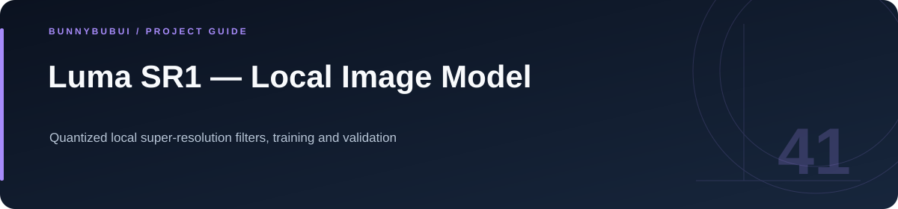

<p align="center">
  
</p>

<h1 align="center">Luma SR1 — Local Image Model</h1>

<p align="center">Quantized local super-resolution filters, training and validation</p>

<p align="center">
      
</p>

<p align="center"><a href="#overview">ภาพรวม</a> · <a href="#start">เริ่มใช้งาน</a> · <a href="#structure">ไฟล์สำคัญ</a></p>

<a id="overview"></a>

## ภาพรวม

โมเดล SR1 สำหรับเพิ่มรายละเอียด luminance ของภาพบนเครื่อง ใช้ชุด ridge-regression filters และ inference ใน Java แยกจากโค้ด UI ของแอปกล้อง

<a id="start"></a>

## ฝึกและตรวจโมเดล

รันจาก root ของ LumaCamera หลังติดตั้ง NumPy และ Pillow

```sh
OPENBLAS_NUM_THREADS=1 python3 model/train.py
sha256sum -c model/SHA256SUMS
./gradlew :app:testDebugUnitTest
```

โมเดลที่ใช้ในแอปมี weights และ checksum อยู่ใน repo ผลจากภาพทดสอบไม่ใช่การรับรองคุณภาพบนอุปกรณ์ทุกเครื่อง

<a id="structure"></a>

## ไฟล์สำคัญ

| ตำแหน่ง | หน้าที่ |
|---|---|
| [train.py](train.py) | ไฟล์ต้นฉบับ / การตั้งค่า |

<a id="reading"></a>

## อ่านต่อ

- [รายละเอียด implementation](docs/IMPLEMENTATION_GUIDE.md)
- [กลับ README หลัก](../README.md)


---

<p align="center"><a href="https://github.com/BunnyBubui">BunnyBubui</a> · <a href="https://github.com/BunnyBubui/test">Software Portfolio</a></p>
